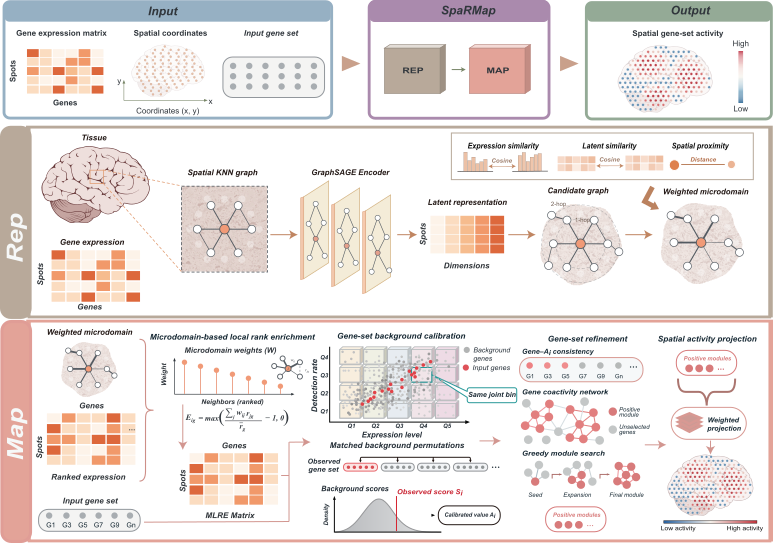

# SpaRMap

SpaRMap maps predefined gene set activity across spatial locations in spatial
transcriptomics data. It takes gene expression counts, spatial coordinates and
gene sets as input, and combines weighted spatial microdomains with background
calibration to estimate spatial activity scores and identify co-enriched gene
modules. Results are provided as annotated H5AD files and gene/module tables.

## Overview

SpaRMap consists of two stages:

- **Spatial representation learning (REP)** integrates gene expression and
  spatial neighborhoods to learn latent representations and construct adaptive,
  weighted spatial microdomains.
- **Gene set mapping (MAP)** integrates local expression ranks within these
  microdomains, calibrates activity against genes matched for expression abundance
  and detection rate, and identifies co-enriched gene modules for spatial activity
  scoring.

REP is independent of the input gene sets, so its representations and microdomains
can be reused to map additional gene sets from the same samples.



## Installation

SpaRMap requires **Python 3.9 or later**. The default installation below selects
PyTorch 2.5.1 with CUDA 12.4 for NVIDIA GPUs, including the RTX 4090, on Windows
or Linux. Use a CUDA 12.4-compatible NVIDIA driver.

Clone this GitHub repository or download its source archive, then install from
the repository root:

```bash
python -m pip install . "torch==2.5.1+cu124" --extra-index-url https://download.pytorch.org/whl/cu124
```

This command automatically installs the Python dependencies, including PyTorch,
listed in [pyproject.toml](pyproject.toml).

Other builds are listed in the
[official PyTorch installation instructions](https://pytorch.org/get-started/previous-versions/#v251).
SpaRMap uses GPU `0` when CUDA is available and otherwise runs on CPU.

## Usage

With SpaRMap, you can:

- Learn spatial representations and construct weighted spatial microdomains.
- Map gene set activity and identify co-enriched gene modules.
- Analyze individual samples or multiple tissue sections, and reuse REP for
  additional gene sets.

Run from Python:

```python
from sparmap import sparmap

adata_map = sparmap("input.h5ad", "gene_set.csv")
```

Or use the command line:

```bash
sparmap --raw-h5ad input.h5ad --gene-set gene_set.csv
```

The H5AD should contain raw `layers["counts"]`, `obsm["spatial"]` coordinates and
`obs["sample_id"]` identifiers. Supply a gene set CSV/TSV with a `gene` column.
Results are saved to `result/rep/adata_rep.h5ad` and
`result/map/adata_map.h5ad`, alongside result tables.

Use `--mode multi` for shared REP across two or more samples, and
`sparmap --help` for command-line options.

## Tutorial

The [BRCA tutorial](docs/tutorial/tutorial.md) demonstrates data loading, SpaRMap
analysis, result inspection and spatial visualization using a 399-gene set.

## System Requirements

- **Python:** 3.9 or later, as declared in `pyproject.toml`.
- **Compute:** CPU execution and an optional NVIDIA CUDA GPU path. Memory use
  depends on the number of spatial locations and genes; `--large-effect` reduces
  MAP memory requirements through on-demand, chunked computation.
- **Validated configuration:** local CPU runs on Windows 10 using Python 3.9.21,
  PyTorch 2.5.1, NumPy 1.26.4, Scanpy 1.10.3 and HarmonyPy 0.0.10.
- **Additional validation:** Linux, macOS and CUDA execution remain to be tested
  for this release.

## Citation

Manuscript citation details will be added when available.

## License

**Pending:** the project license has not yet been specified, and a `LICENSE` file
has yet to be added.
