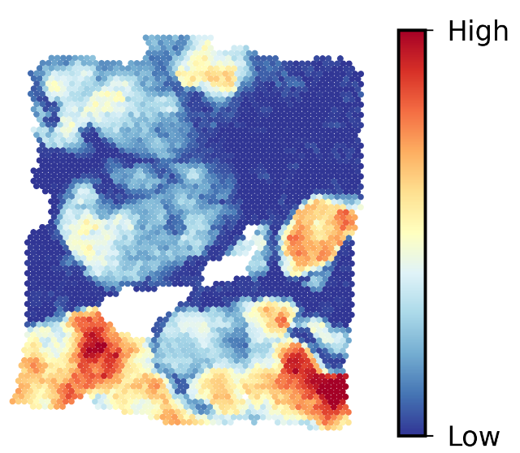
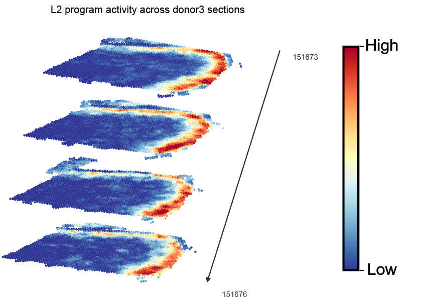

# SpaRMap Tutorial

Yao Zhou, Chao Song, YiChen Gao, LiYuan Liu, Kewei Wang, Qiuyu Wang\*, Chunquan Li\*

This tutorial maps a 399-gene TCGA-BRCA unfavorable prognostic gene set onto the
BRCA spatial transcriptomics sample BAS1 using SpaRMap. The final section
demonstrates joint analysis of four DLPFC tissue sections.

## Outline

1. [Installation](#1-installation)
2. [Import modules](#2-import-modules)
3. [Read in data](#3-read-in-data)
4. [Run SpaRMap](#4-run-sparmap)
5. [Explore the results](#5-explore-the-results)
6. [Plot spatial gene set activity](#6-plot-spatial-gene-set-activity)
7. [Multiple tissue sections analysis](#7-multiple-tissue-sections-analysis)

## 1. Installation

SpaRMap requires Python 3.9 or later. The installation examples below use
PyTorch 2.5.1 with CUDA 12.4 and a compatible NVIDIA driver. We recommend a
dedicated Anaconda environment for the tutorial.

### 1.1 PyPI

PyPI installation instructions will be added with the package release.

### 1.2 GitHub

Clone the repository and install SpaRMap from its root directory:

```bash
git clone https://github.com/zhoumuci/SpaRMap.git
cd SpaRMap
python -m pip install . "torch==2.5.1+cu124" --extra-index-url https://download.pytorch.org/whl/cu124
```

### 1.3 Anaconda

To install SpaRMap in a dedicated environment:

```bash
conda create -n sparmap python=3.9 pip
conda activate sparmap
git clone https://github.com/zhoumuci/SpaRMap.git
cd SpaRMap
python -m pip install . "torch==2.5.1+cu124" --extra-index-url https://download.pytorch.org/whl/cu124
```

Run the following Python code from the SpaRMap repository root.

## 2. Import modules

```python
from pathlib import Path

import anndata as ad
import matplotlib.pyplot as plt
import numpy as np
import pandas as pd
from matplotlib import gridspec
from matplotlib.cm import ScalarMappable
from matplotlib.colors import Normalize
from scipy.spatial import cKDTree

from sparmap import sparmap
```

## 3. Read in data

Download `BRCA.h5ad` and `tcga_brca_unfavorable_gene_set.csv` from the
[BRCA folder on Google Drive](https://drive.google.com/drive/folders/1y5D9K-djexiboFaq1RL1hrKVkM5whKCm?usp=sharing)
and place both files in `data/BRCA/`:

```text
SpaRMap/
  data/
    BRCA/
      BRCA.h5ad
      tcga_brca_unfavorable_gene_set.csv
```

`BRCA.h5ad` contains the expression data and spatial coordinates for BAS1.
Raw counts are stored in `layers["counts"]`, coordinates in `obsm["spatial"]`,
and sample identifiers in `obs["sample_id"]`. The CSV supplies the 399 genes
used in this example through its `gene` column.

```python
data_dir = Path("data/BRCA")
adata_path = data_dir / "BRCA.h5ad"
gene_set_path = data_dir / "tcga_brca_unfavorable_gene_set.csv"

adata = ad.read_h5ad(adata_path)
gene_set = pd.read_csv(gene_set_path)

print(adata)
print("Number of genes in the gene set:", gene_set["gene"].nunique())
```

View the sample annotations, coordinates and gene list:

```python
adata.obs[["sample_id"]].head()
```

```python
adata.obsm["spatial"][:5]
```

```python
gene_set[["gene"]].head()
```

## 4. Run SpaRMap

Run the analysis with the default model settings:

```python
adata_map = sparmap(adata_path, gene_set_path)
```

`sparmap()` performs quality control and expression preprocessing, learns spatial
representations and weighted microdomains, and maps the gene set activity. REP
training is displayed as one progress bar for this sample. The function returns
the mapped AnnData object and saves the results under `result/`.

## 5. Explore the results

The final REP and MAP objects are saved as `result/rep/adata_rep.h5ad` and
`result/map/adata_map.h5ad`. The primary spatial activity score is stored in
`adata_map.obs["map_single_active_module_positive"]`.

```python
score_key = "map_single_active_module_positive"
adata_map.obs[["sample_id", score_key]].head()
```

The CSV tables in `result/map/` describe the inferred gene relationships and
modules:

| File | Content |
| --- | --- |
| `single_map_edge_table.csv` | Gene relationships within each sample and gene set. |
| `single_map_positive_module_table.csv` | Positive modules and their scores. |
| `single_map_negative_module_table.csv` | Negative modules and their scores. |
| `single_map_module_gene_table.csv` | Genes belonging to each module. |
| `single_map_sample_summary.csv` | Sample-level module and projection summaries. |
| `single_map_program_summary.csv` | Gene set summaries across samples. |
| `single_map_score_spec.csv` | Score roles and their AnnData field names. |

Inspect the positive modules:

```python
map_dir = Path("result/map")
positive_modules = pd.read_csv(map_dir / "single_map_positive_module_table.csv")
positive_modules[["program", "sample_id", "module_id", "n_genes", "module_score"]].head()
```

## 6. Plot spatial gene set activity

Select BAS1 and align its activity scores with the input spatial locations:

```python
adata_plot = adata[adata.obs["sample_id"].astype(str) == "BAS1"]
coords = np.asarray(adata_plot.obsm["spatial"], dtype=float)[:, :2]
scores = adata_map.obs[score_key].reindex(adata_plot.obs_names).to_numpy(dtype=float)

coord_finite = np.isfinite(coords).all(axis=1)
score_finite = np.isfinite(scores)
vmin, vmax = np.percentile(scores[score_finite], [10.0, 99.5])
```

Use the `RdYlBu_r` colormap and the 10th and 99.5th percentiles as the display
limits. Spot areas are calculated from the spatial spacing, using a scale of
`0.55` and a range of `2.6` to `10.0` points squared.

```python
fig = plt.figure(figsize=(1.6, 1.5))
gs = gridspec.GridSpec(
    1, 2, figure=fig, width_ratios=[1.5, 0.10], wspace=0.03,
    left=0.01, right=0.99, bottom=0.02, top=0.98,
)
ax = fig.add_subplot(gs[0, 0])
cax = fig.add_subplot(gs[0, 1])

xy = coords[coord_finite]
distances, _ = cKDTree(xy).query(xy, k=2)
nearest = distances[:, 1]
spacing = float(np.median(nearest[np.isfinite(nearest) & (nearest > 0)]))

fig.canvas.draw()
bbox = ax.get_window_extent().transformed(fig.dpi_scale_trans.inverted())
x_range = max(float(np.ptp(xy[:, 0])), 1.0)
y_range = max(float(np.ptp(xy[:, 1])), 1.0)
width_pt = max(bbox.width * 72.0, 1.0)
height_pt = max(bbox.height * 72.0, 1.0)
points_per_coord = min(width_pt / x_range, height_pt / y_range)
diameter_pt = spacing * points_per_coord * 0.55
spot_size = float(np.clip(diameter_pt * diameter_pt, 2.6, 10.0))

missing = coord_finite & ~score_finite
ax.scatter(
    coords[missing, 0], coords[missing, 1],
    s=spot_size, c="#F2F2F2", marker="o", linewidths=0,
)

color_mask = coord_finite & score_finite
finite_coords = coords[color_mask]
finite_scores = scores[color_mask]
order = np.argsort(finite_scores)
ax.scatter(
    finite_coords[order, 0], finite_coords[order, 1],
    s=spot_size, c=finite_scores[order], cmap="RdYlBu_r",
    norm=Normalize(vmin=vmin, vmax=vmax), marker="o", linewidths=0,
)

xmin, xmax = float(xy[:, 0].min()), float(xy[:, 0].max())
ymin, ymax = float(xy[:, 1].min()), float(xy[:, 1].max())
xpad = max((xmax - xmin) * 0.02, 1e-6)
ypad = max((ymax - ymin) * 0.02, 1e-6)
ax.set_xlim(xmin - xpad, xmax + xpad)
ax.set_ylim(ymax + ypad, ymin - ypad)
ax.set_aspect("equal")
ax.set_axis_off()

mappable = ScalarMappable(norm=Normalize(0.0, 1.0), cmap="RdYlBu_r")
mappable.set_array(np.asarray([0.0, 1.0]))
colorbar = fig.colorbar(mappable, cax=cax)
colorbar.set_ticks([0.0, 1.0])
colorbar.set_ticklabels(["Low", "High"])
colorbar.set_label("")
colorbar.ax.tick_params(labelsize=7.0, length=2, width=0.4)

fig.savefig(map_dir / "BRCA_spatial_map.png", dpi=600, bbox_inches="tight")
fig.savefig(map_dir / "BRCA_spatial_map.pdf", dpi=600, bbox_inches="tight")
plt.show()
```

The spatial map below shows the activity of the BRCA gene set in BAS1. Warmer
colors indicate higher activity, and cooler colors indicate lower activity.



## 7. Multiple tissue sections analysis

This example maps an L2 marker gene set across four DLPFC sections from donor 3:
`151673`, `151674`, `151675` and `151676`.

### 7.1 Download and prepare the data

The [DLPFC folder on Google Drive](https://drive.google.com/drive/folders/12qKDsSx1nWlIqe4uiqKvlJ6DachbJN2m?usp=sharing)
provides two input options: a combined H5AD and the four original section
folders. Choose **Option A** to use the combined H5AD directly, or **Option B**
to build it from the original files.

Both options use the L2 gene set
[`gene_set/HE_2017_HUMAN_PFC_L2_HLM_2FC.csv`](https://drive.google.com/file/d/1hfuWANxiHoyvQ1BjRaSoDEuRF8_na1qq/view),
available in the DLPFC folder's
[`gene_set` subfolder](https://drive.google.com/drive/folders/1LfKhtu9ovdF9P_8QJfiUEMRrYdTjlLas?usp=sharing).
Save it locally under `data/DLPFC/gene_set/`.

Set the local paths before following either option:

```python
dlpfc_dir = Path("data/DLPFC")
dlpfc_path = dlpfc_dir / "DLPFC_donor3_4sections_multi.h5ad"
l2_gene_set = dlpfc_dir / "gene_set/HE_2017_HUMAN_PFC_L2_HLM_2FC.csv"
sections = ["151673", "151674", "151675", "151676"]
```

#### Option A: Use the combined H5AD

Download
[`DLPFC_donor3_4sections_multi.h5ad`](https://drive.google.com/file/d/1IbIYuDRAdYt7lOEK7n9WBKfS2KF804pt/view)
and the L2 gene set. This route requires these two files:

```text
data/DLPFC/
  DLPFC_donor3_4sections_multi.h5ad
  gene_set/
    HE_2017_HUMAN_PFC_L2_HLM_2FC.csv
```

The H5AD already contains all four sections. **Skip Option B and continue
directly to [Section 7.2](#72-run-sparmap-across-sections).**

#### Option B: Combine the original sections

Download the four section folders (`151673`, `151674`, `151675` and `151676`)
and the L2 gene set. Arrange the files used below as follows:

```text
data/DLPFC/
  gene_set/
    HE_2017_HUMAN_PFC_L2_HLM_2FC.csv
  151673/
    151673_filtered_feature_bc_matrix.h5
    spatial/
      tissue_positions_list.csv
  151674/
    151674_filtered_feature_bc_matrix.h5
    spatial/
      tissue_positions_list.csv
  151675/
    151675_filtered_feature_bc_matrix.h5
    spatial/
      tissue_positions_list.csv
  151676/
    151676_filtered_feature_bc_matrix.h5
    spatial/
      tissue_positions_list.csv
```

**Run the following code to create the combined H5AD before continuing to
Section 7.2.** It reads each count matrix, attaches spatial coordinates and
section identifiers, and concatenates the sections along the observation axis:

```python
import scanpy as sc

position_columns = [
    "barcode", "in_tissue", "array_row", "array_col", "pixel_row", "pixel_col",
]
section_data = []

for sid in sections:
    section_dir = dlpfc_dir / sid
    section = sc.read_10x_h5(section_dir / f"{sid}_filtered_feature_bc_matrix.h5")
    section.var_names_make_unique()
    section.layers["counts"] = section.X.copy()

    positions = pd.read_csv(
        section_dir / "spatial/tissue_positions_list.csv",
        header=None, names=position_columns, index_col="barcode",
    ).loc[section.obs_names]
    section.obsm["spatial"] = positions[["pixel_col", "pixel_row"]].to_numpy(dtype=float)
    section.obs["sample_id"] = sid
    section.obs["barcode_raw"] = section.obs_names.astype(str)
    section.obs_names = [f"{sid}_{barcode}" for barcode in section.obs_names]
    section_data.append(section)

dlpfc = ad.concat(section_data, axis=0, join="inner", merge="same")
dlpfc.write_h5ad(dlpfc_path)
```

This creates `data/DLPFC/DLPFC_donor3_4sections_multi.h5ad`. Continue to
[Section 7.2](#72-run-sparmap-across-sections) using this file.

### 7.2 Run SpaRMap across sections

Both input routes provide raw counts in `layers["counts"]`, spatial coordinates
in `obsm["spatial"]` and section identifiers in `obs["sample_id"]`, with unique
observation names across sections. Harmony is applied during SpaRMap's
multi-section REP preprocessing.

Read the combined input and inspect the section identifiers:

```python
dlpfc = ad.read_h5ad(dlpfc_path, backed="r")
print(dlpfc)
print(dlpfc.obs["sample_id"].astype(str).value_counts().sort_index())
dlpfc.file.close()
```

Select `mode="multi"` to use shared PCA, Harmony and one REP model across the
four sections. By default, Harmony uses `sample_id` as the batch column.
Spatial graphs, microdomains and MAP calculations are computed within each
section.

```python
dlpfc_outdir = Path("result/DLPFC_L2")
adata_dlpfc_map = sparmap(
    dlpfc_path,
    l2_gene_set,
    outdir=dlpfc_outdir,
    mode="multi",
)
```

The remaining model settings use their defaults. The final objects are saved to
`result/DLPFC_L2/rep/adata_rep.h5ad` and
`result/DLPFC_L2/map/adata_map.h5ad`, alongside the MAP tables.

```python
score_key = "map_single_active_module_positive"
adata_dlpfc_map.obs[["sample_id", score_key]].head()
```

### 7.3 Plot the sections as a vertical stack

Use a common color scale across the four sections, with the 10th and 99.5th
percentiles of their pooled scores as the display limits. The sections are shown
from top to bottom in the order `151673`, `151674`, `151675`, `151676`.
Coordinates are centered and scaled jointly, then offset for the stacked view.

```python
sample_ids = adata_dlpfc_map.obs["sample_id"].astype(str).to_numpy()
coords = np.asarray(adata_dlpfc_map.obsm["spatial"], dtype=float)[:, :2]
scores = adata_dlpfc_map.obs[score_key].to_numpy(dtype=float)

vmin, vmax = np.percentile(scores, [10.0, 99.5])
norm = Normalize(vmin=vmin, vmax=vmax, clip=True)
center = 0.5 * (coords.min(axis=0) + coords.max(axis=0))
span = max(float(np.ptp(coords[:, 0])), float(np.ptp(coords[:, 1])), 1.0)
plot_xy = (coords - center) / span
plot_xy[:, 1] *= -1.0

mean_spots = np.mean([np.sum(sample_ids == sid) for sid in sections])
point_size = float(np.clip(15000.0 / max(mean_spots, 1.0), 3.2, 9.0))
z_gap, x_gap, y_gap = 0.62 * 0.68, 0.10 * 0.70, 0.04 * 0.70

fig = plt.figure(figsize=(8.8, 6.0), facecolor="white")
ax = fig.add_subplot(111, projection="3d")
display_xy = []

for index, sid in enumerate(sections):
    mask = sample_ids == sid
    level = len(sections) - 1 - index
    xy = plot_xy[mask] + [level * x_gap, level * y_gap]
    section_scores = scores[mask]
    order = np.argsort(section_scores)
    ax.scatter(
        xy[order, 0], xy[order, 1], np.full(order.size, level * z_gap),
        c=section_scores[order], cmap="RdYlBu_r", norm=norm,
        s=point_size, marker="o", edgecolors="none", linewidths=0,
        alpha=1.0, depthshade=False, rasterized=False,
    )
    display_xy.append(xy)

display_xy = np.concatenate(display_xy)
xpad = max(0.07 * float(np.ptp(display_xy[:, 0])), 0.04)
ypad = max(0.08 * float(np.ptp(display_xy[:, 1])), 0.04)
ax.set_xlim(display_xy[:, 0].min() - xpad, display_xy[:, 0].max() + xpad)
ax.set_ylim(display_xy[:, 1].min() - ypad, display_xy[:, 1].max() + ypad)
ax.set_zlim(-0.08 * z_gap, (len(sections) - 1 + 0.18) * z_gap)
ax.view_init(elev=18.0, azim=-62.0)
ax.set_proj_type("ortho")
ax.set_box_aspect((1.2, 1.0, 1.12))
ax.set_axis_off()

fig.suptitle("L2 program activity across donor3 sections", fontsize=10.5, y=0.96)
cax = fig.add_axes((0.875, 0.24, 0.020, 0.50))
mappable = ScalarMappable(norm=norm, cmap="RdYlBu_r")
mappable.set_array([])
colorbar = fig.colorbar(mappable, cax=cax)
colorbar.set_ticks([vmin, vmax])
colorbar.set_ticklabels(["Low", "High"])
colorbar.ax.tick_params(labelsize=7.5, length=0)
fig.subplots_adjust(left=0.035, right=0.85, bottom=0.055, top=0.91)

dlpfc_map_dir = dlpfc_outdir / "map"
fig.savefig(dlpfc_map_dir / "DLPFC_L2_stacked.png", dpi=900, bbox_inches="tight")
fig.savefig(dlpfc_map_dir / "DLPFC_L2_stacked.pdf", dpi=900, bbox_inches="tight")
plt.show()
```

The example below shows L2 gene set activity across the four DLPFC sections.
Warmer colors indicate higher activity, and cooler colors indicate lower activity.


